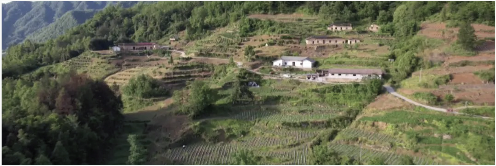
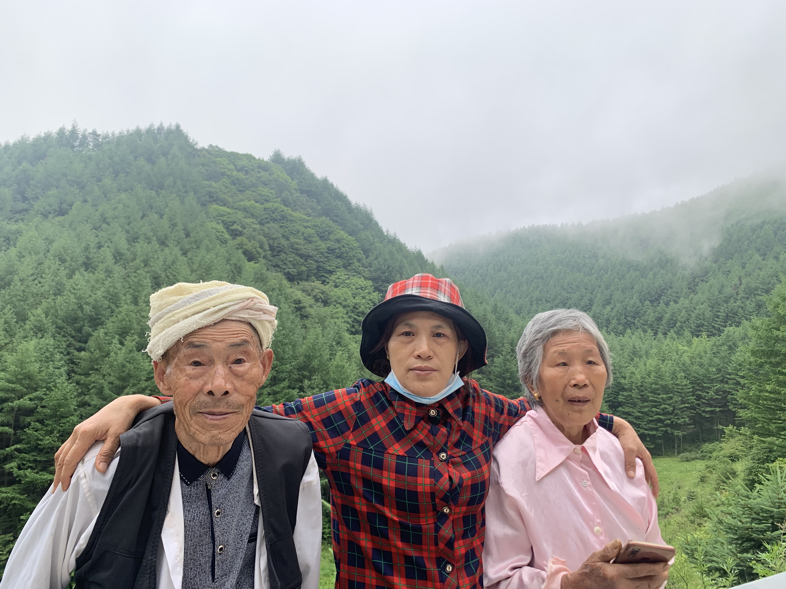
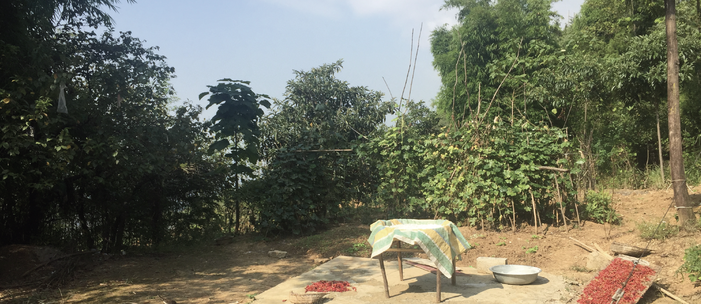
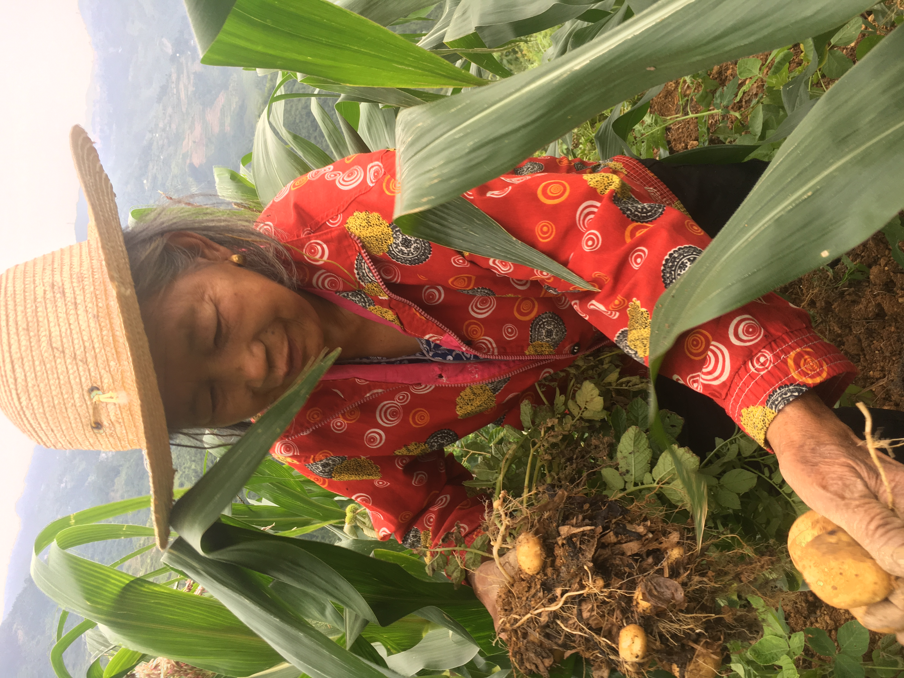

## My Submission

### Title: My grandparents' house

  Figure 1. A village similar to my grandparents’ house.
   Link: https://www.sohu.com/a/680902068_121123737

My grandparents's house is in a small village located in Wushan County,
Chongqing City, by the Yangtze River, the longest river in China. The
village is quiet, peaceful, and beautiful. Mountains, trees, farmlands
and bushes surround it. The population of the village is extremely low;
it must have at most 20 houses. The majority of families are scattered
at both ends of the mountain, the peak and the bottom. My grandparents'
house is located in the middle of the
mountain.

  Figure 2. My mom and grandparents in the
forest

I had lived with my grandparents until I was 10 because of the family
planning policy and my parents' work. The policy says that a family can
have only one child. However, I am the second boy in my family. So my
parents hid me at my grandparents' when I was 3 months old. My mother
suffered a lot when I was an infant. She often took an hour and a half
to get to my grandparents' house at night, and fed me some milk. Then
she would return home before dawn. Two years later, my parents left
Wushan County to work in the city. Then I became the stay-at-home child,
cared for by my grandparents.

A Chinese proverb goes "The old man lost his horse (but it all turned
out for the best)", also known as "Bad luck? Good luck? Who knows?".
Despite these things, I had a very happy and worry-free childhood, and
my grandparents favored me. I still remember that my grandma gave me
some extra boiled eggs exclusively, and my grandpa liked accompanying me
when he went out.

  Figure 3. The front yard of the house

Life there was really like the Swiss-German film Heidi by Alain Gsponer.
I usually woke up at 7 o'clock and washed my face. Then I would be
assigned little tasks, such as cooking breakfast for the family. I
prepared the gradients: nail potatoes, wash sweet potatoes. Then put
them in the pot. Lastly, do the most important thing: tend the fire.

Sometimes I went to the fields with my grandparents. I could help them
weed the farmland, water the vegetable field, and fertilize the crops,
etc. When it comes to farming, one thing I still remember clearly is
that potatoes and corn need to be planted together. So that the corn
leaves will prevent the hot sunlight from reaching the potato plants. I
would feel delighted when it comes to harvest.

  Figure 3. The front yard of the house

During that time, I would assist my grandparents by collecting and
transporting the fruits. They would be pleased and would give me some
new stationery or snacks as rewards.

Compared with planting, I prefer grazing livestock. We had one cow and
one donkey. I took them out and found a flourishing site for them. I
always laid down on the green grass, staring at the clouds. The shape of
the clouds varies; at this time, it's a rabbit, but in a few seconds, it
will become a horse. Sometimes, you could see people up there chasing
each other. When I enjoyed the scene, I would fall asleep quickly. With
no exception, I would be woken up by my grandma's voice as she found
that the cow was on the farmland eating vegetables.

In the summer night, we would sleep outside for cold wind as there were
no electrical fans or air conditioners. Before I fell asleep, my eyes
were filled with bright moon and full of shining stars. In the winter, I
usually sit by the campfire, asking my grandparents, telling stories.
Some of them scared me a lot, I could not go out alone at night.
However, my curiosity was satisfied.

It has been 23 years, and I can still remember the time vividly with my
grandparents there. Their personalities, hard-working, optimistic and
warm-hearted benefit me at every moment of my life.

## The feedback of the professor

Chengbin, You create a vivid picture of your grandparents’ home and the childhood you experienced there, especially through memories of tending the fire, working in the fields, grazing the cow and donkey, watching clouds, sleeping beneath the stars, and listening to your grandparents’ stories.

Moving forward:

Friendly Reminder: Review the overview module Writing to Locate Instructions for a clear idea of what to include within your final draft. Remember that the Final Draft criteria are lengthier and more rigorous and can be found in “Prepare – Instructions for Writing Project #1: Writing to Locate.” 

**The goal is to explain, through detailed analysis and reflection, how a specific place has impacted your worldview and how that view has shaped you as a writer.**

For the Final Draft, **narrow your focus to one exact spot** and one defining experience with your grandparents; sitting beside the winter campfire listening to their stories could provide an especially strong focus. Then move beyond describing these cherished memories **to explain what that experience changed in your worldview and, most importantly, how that changed perspective shaped you as a writer.**

The current draft ends by identifying your grandparents as hardworking, optimistic, and warm-hearted, but **the required writing connection has not yet been developed.** 

**While photos are included, they are not all embedded in the narrative.** I suggest to also resize your photos so they enhance, rather than overpower, the paragraphs; consider placing them beside the most important scenes with brief explanations of their significance.

For the final draft, ensure that each image appears within the essay and provide brief captions explaining their significance. This will make your photo essay more multimodal and visually engaging.

Debra

## The rubric table

<table>
  <caption>Writing to Locate Rough Draft Rubric</caption>
  <thead>
    <tr>
      <th>Criteria</th>
      <th>Meets Expectations</th>
      <th>Approaches Expectations</th>
      <th>Does Not Meet Expectations</th>
      <th>Score</th>
    </tr>
  </thead>

  <tbody>
    <tr>
      <td><strong>Length</strong></td>
      <td>
        <strong>15 pts</strong> 
        The rough draft is at least 500 words in length.
      </td>
      <td>
        <strong>11 pts</strong> 
        The rough draft is shorter than 500 words but at least 250 words in length.
      </td>
      <td>
        <strong>0 pts</strong> 
        The rough draft is shorter than 250 words in length.
      </td>
      <td><strong>15 / 15 pts</strong></td>
    </tr>
    <tr>
      <td><strong>Place, Perspective, and Writing</strong></td>
      <td>
        <strong>15 pts</strong> 
        The rough draft identifies a place that has shaped your perspectives and/or personality,
        and explains how those perspectives shape your approach to writing.
      </td>
      <td>
        <strong>11 pts</strong> 
        The rough draft mentions how a place has shaped your perspectives and/or personality,
        and mentions how those perspectives shape your approach to writing, but one or both of
        these aspects could be developed further. Or, one of these aspects (how a place has shaped
        your perspectives and/or personality, or how these perspectives shape your approach to
        writing) is missing.
      </td>
      <td>
        <strong>0 pts</strong> 
        The rough draft does not identify a place that has shaped your perspectives and/or
        personality, or explain how those perspectives shape your approach to writing.
      </td>
      <td><strong>11 / 15 pts</strong></td>
    </tr>
    <tr>
      <td><strong>Images</strong></td>
      <td>
        <strong>10 pts</strong> 
        The rough draft includes 3 or more images that are embedded in appropriate places
        within the essay.
      </td>
      <td>
        <strong>7 pts</strong> 
        The rough draft includes 1–2 images that are embedded in appropriate places within
        the essay. Or, the rough draft includes 3 or more images, but they are not embedded
        in appropriate places in the essay.
      </td>
      <td>
        <strong>0 pts</strong> 
        The rough draft includes no images.
      </td>
      <td><strong>8 / 10 pts</strong></td>
    </tr>
    <tr>
      <td><strong>Organization</strong></td>
      <td>
        <strong>10 pts</strong> 
        The rough draft is organized into cohesive and logical paragraphs.
      </td>
      <td>
        <strong>7 pts</strong> 
        The rough draft is organized into paragraphs, but the paragraphs could be more
        cohesive and/or more logically organized.
      </td>
      <td>
        <strong>0 pts</strong> 
        The rough draft is not organized into paragraphs and the draft is not logically organized.
      </td>
      <td><strong>9 / 10 pts</strong></td>
    </tr>
    <tr>
      <td colspan="3" style="text-align: right;">
        <strong>Total Points</strong>
      </td>
      <td colspan="2">
        <strong>43 / 50 pts</strong>
      </td>
    </tr>
  </tbody>
</table>